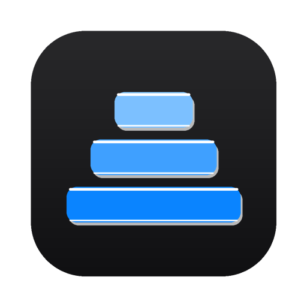
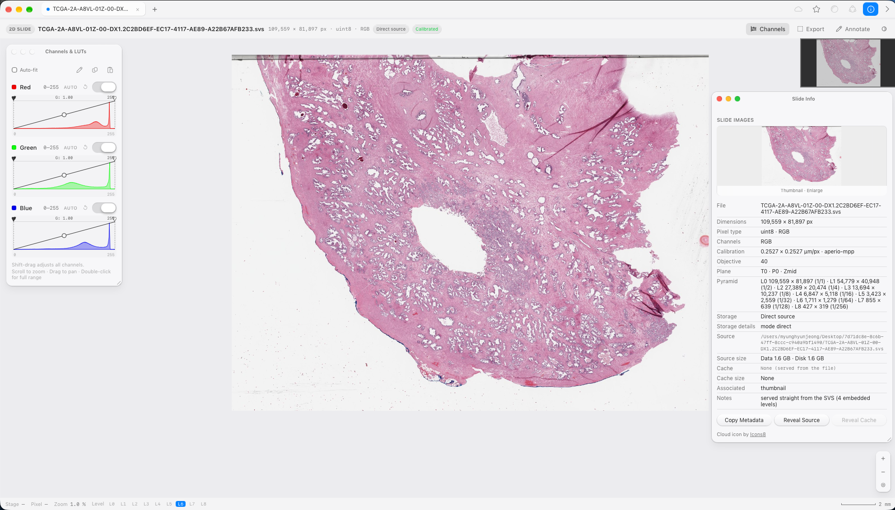
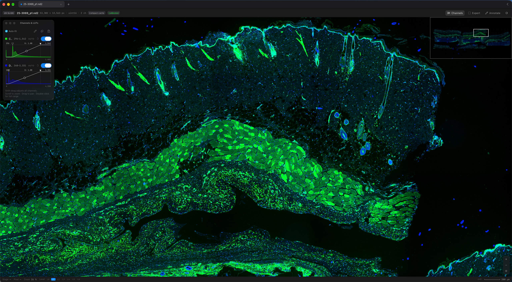
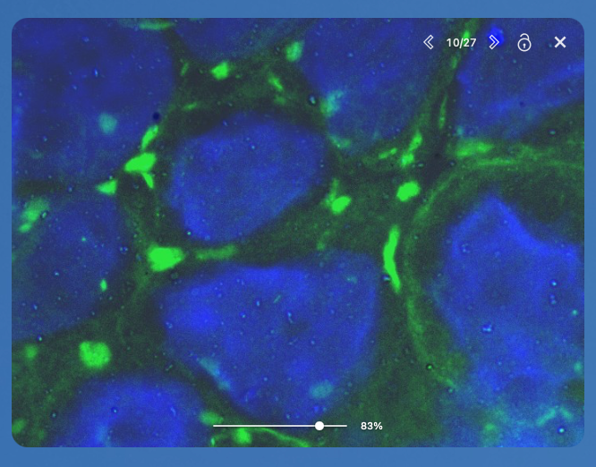
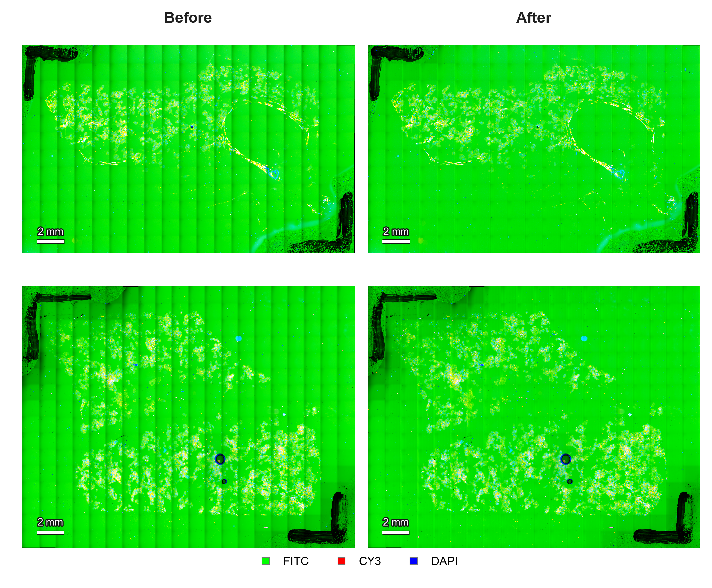

  

<h1 align="center">nd2wsi-viewer</h1>

  <strong>Browse whole slides. Inspect channels. Export the region you need.</strong> 
  A local microscopy viewer for macOS and Windows. 
  <strong>Supported formats:</strong> JPG · PNG · ND2 · SVS · <a href="docs/sdpc-support.md">SDPC</a>

  <a href="#download">Download</a> ·
  <a href="#features">Features</a> ·
  <a href="docs/user-guide.md">User guide</a> ·
  <a href="https://github.com/myunghyunj/nd2wsi-viewer/releases">Release notes</a> ·
  <a href="docs/user-guide.md#numbered-regions-with-astromapper" title="Astromapper">☆</a>

## Latest update

- **Windows saves before closing:** closing a window now waits for annotation, LUT and export work, as on macOS; an unresponsive viewer can still be closed after confirmation.
- **Faster display:** tile compositing is 4–5 times faster with bit-identical colours.
- **Smooth annotation panning:** thousands of Astromapper regions pan at full frame rate.
- **Faster TIFF export:** reduced-level exports read each channel once; files are byte-identical.

  

## Download

| Platform | Download · 2.5.4 | Requirements |
| --- | --- | --- |
| macOS | [DMG](https://github.com/myunghyunj/nd2wsi-viewer/releases/download/v2.5.4/nd2wsi-viewer-2.5.4-macos-arm64.dmg) | Apple silicon · macOS 14 or later |
| Windows | [Portable ZIP](https://github.com/myunghyunj/nd2wsi-viewer/releases/download/v2.5.4/nd2wsi-viewer-2.5.4-windows-x64.zip) | x64 · Windows 11 ARM64 through x64 emulation · WebView2 |

On macOS, drag the app into **Applications**. On Windows, extract the entire ZIP
and keep `_internal` beside `nd2wsi-viewer.exe`. See the
[installation guide](docs/user-guide.md#get-started) for first-launch prompts.

Drop an image into the window or use **+**. The first open of a stitched ND2 may
prepare a viewing cache; later opens reuse it.

Try the public CC0 examples:
[three-channel cells, 28 MB](https://github.com/myunghyunj/nd2wsi-viewer/releases/download/testdata-v1/example_cell.nd2) ·
[two-channel tissue, 47 MB](https://github.com/myunghyunj/nd2wsi-viewer/releases/download/testdata-v1/example_tissue.nd2).

## Features

### Channels & LUTs

- Set each channel's colour, visibility, intensity range and gamma.
- Drag the histogram controls, enter exact values, or use **Auto** for contrast.
- **Copy / Paste** transfers minimum, maximum and gamma between matching channel names.
- The standard viewer restores each file's last-used minimum, maximum and gamma when you reopen it, including after restarting the app.

**Auto-fit** fits the histogram axis to the signal; it does not change contrast.
These display controls leave source pixels unchanged.

### Annotations

Add calibrated rulers, pins and boxes with notes. Export annotations as
**GeoJSON**, or import a `.geojson` file through the annotation panel's **Open**
button. Imported marks are added to existing annotations in the original image's
pixel coordinates. [Annotation guide](docs/user-guide.md#measuring-and-marking).

### Export

Select a region and export source channels as **ND2 / TIFF**, or the current
colours and contrast as **PNG / JPEG**. Add a calibrated scale bar directly to
an image or as an editable **SVG**. Full-resolution data exports preserve source
values; smaller exports resample the image. [Export options](docs/user-guide.md#cutting-out-a-region).

### Link and compare

Compare up to four images at the same physical scale. Match recognizable tissue
features with **Align** to calibrate orientation and manually align serial sections.
With **Link scale + frame**, hold **Shift** while dragging to adjust one view.
Finish the drag, release Shift, then pan normally to resume linked movement with
the new offset. This supports visual comparison of serial sections; it does not
establish cell-to-cell correspondence.
[Comparison controls](docs/user-guide.md#comparing-scans-and-serial-sections).

### Translucent viewer

Click the **cloud** to keep the current image above other apps. Adjust its opacity,
navigate imported ROIs, or lock the view while you work underneath it.

### Shading correction

*FITC, CY3 and DAPI composites. Each pair uses the same display settings before
and after correction; DAPI is unchanged.*

Reduce grid-like shadows from uneven illumination by learning the repeating
pattern and adapting its strength across the image. Supported FITC and CY3 channels
are corrected from the slide's fluorescence; BF and DAPI remain unchanged.
[Method and validation limits](docs/shading-correction-validation.md).

## Your files stay local

No upload or account is required. Original images are not modified. Viewing caches
and annotations live in an `nd2wsi` folder beside the image. **Move that folder
with the source image** to keep them together; a compact `.nd2svs` viewing cache
still needs its source for full resolution.

[Storage and portability](docs/user-guide.md#what-the-viewer-writes-on-your-disk) ·
[Plate, time and Z navigation](docs/user-guide.md#time-series-of-a-plate) ·
[Source installation and development](docs/development.md)

Built by Myunghyun Jeong for day-to-day microscopy work.
[Report an issue](https://github.com/myunghyunj/nd2wsi-viewer/issues) with the app
version, platform and file type.

## License

MIT. The example acquisitions are CC0; see [their license](TESTDATA_LICENSE.md).
OpenSeadragon is included under BSD-3-Clause.
Third-party SDPC decoder sources and licenses accompany the binary releases.
