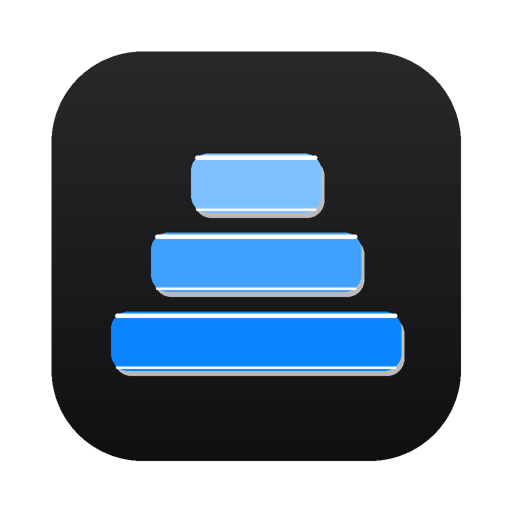
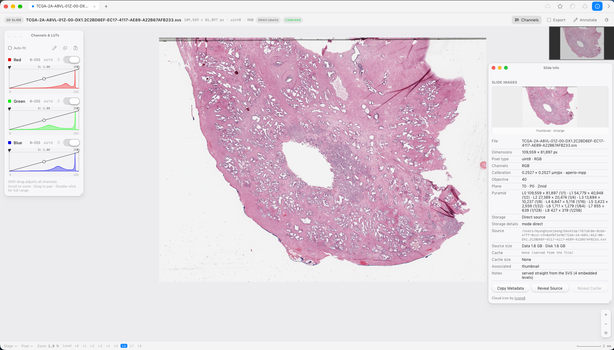
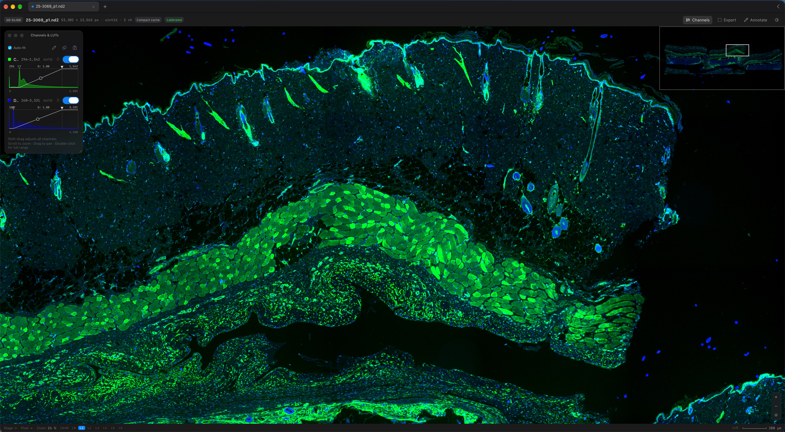
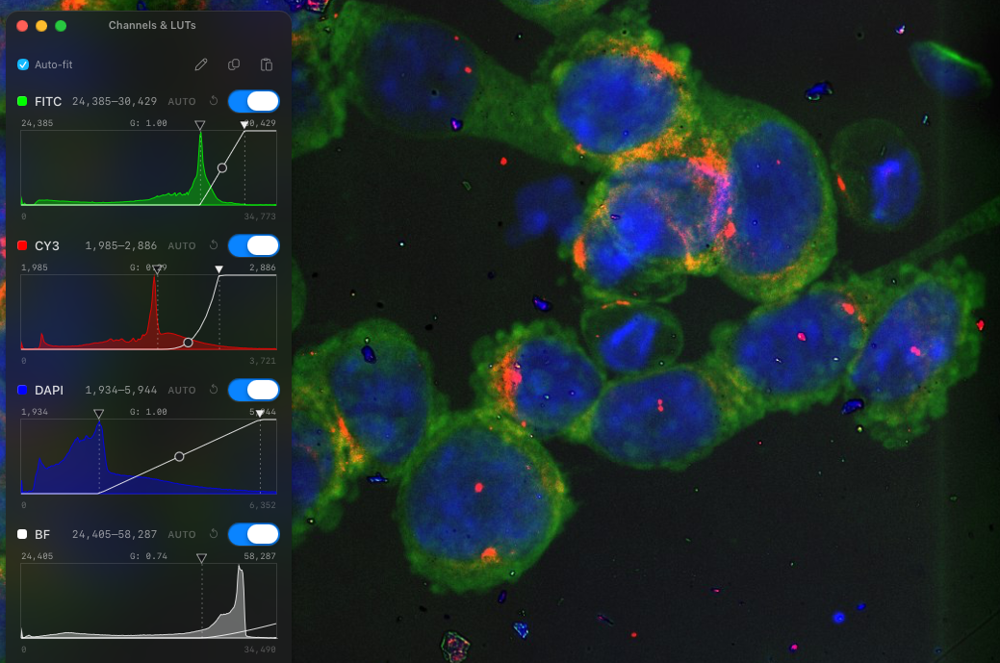
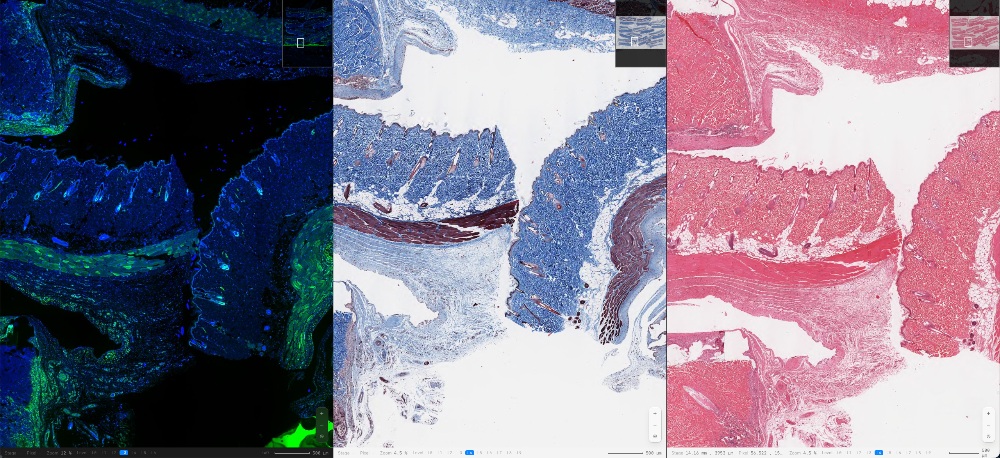
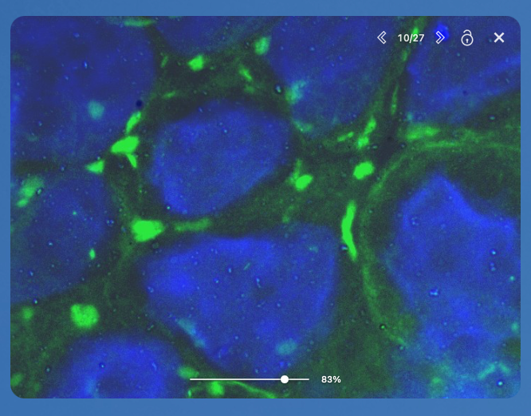
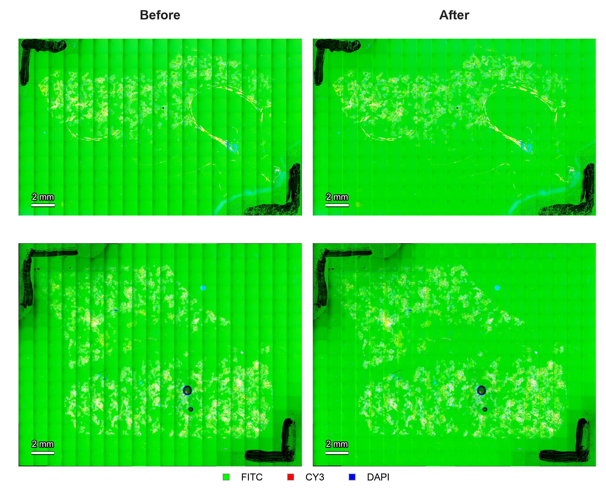

  

<h1 align="center">nd2wsi-viewer</h1>

  <strong>Browse whole slides and confocal stacks. Inspect channels. Export native regions.</strong> 
  A local microscopy viewer for macOS and Windows. 
  <strong>Supported formats:</strong> ND2 · CZI · LIF · OME-TIFF / TIFF · SVS · <a href="docs/sdpc-support.md">SDPC</a> · ND2SVS · JPG · PNG

  <a href="#download">Download</a> ·
  <a href="#features">Features</a> ·
  <a href="docs/user-guide.md">User guide</a> ·
  <a href="https://github.com/myunghyunj/nd2wsi-viewer/releases">Release notes</a> ·
  <a href="docs/user-guide.md#numbered-regions-with-astromapper">Astromap</a>

## Recent updates

- **AstroMapper multi-step resize import, SLACS Stage Follow fixes, multi-channel OME-TIFF fixes & security/lifecycle hardening (`2.6.11`):** keep valid Stage Follow target inputs intact across duplicate stationary position reports, refresh locked translucent click-through regions automatically on panel resize, and release hidden-overlay claims promptly; accept 1-step and 2-step downscaled JPG/PNG AstroMapper reference images with dimension-bearing mismatch diagnostics, UTF-16 BOM ROI text support, PNG reference parity in the translucent viewer, 4,096-character ROI notes, integer-snapped dragged ROI boxes, and aligned 32 MiB ROI TXT export/import limits; fix standards-compliant multi-IFD OME-TIFF 2016-06 output for multi-channel exports, degraded-overview ND2 export guards, and pre-stream export error reporting; and harden Zarr v2 metadata/symlink validation, overwrite conversion safety and `.replaced-*` backup preservation, atomic shading-correction recovery, live-LUT reliability, and NFC/NFD locks with Windows long-path (`\\?\`) support. [2.6.11 release notes](docs/release-notes-2.6.11.md).
- **Live translucent LUT updates & cross-OS exFAT cache portability (`2.6.10`):** sync contrast, gamma, colour, and channel edits live into the translucent viewer during continuous drags with paint-complete redraw gating, preserved lock/ROI alignment, and shading-rebuild expiry notices; preserve `.nd2svs` caches and Korean/non-ASCII sidecars seamlessly between macOS and Windows on external exFAT drives with timestamp-skew tolerance and NFC/NFD Unicode normalization. [2.6.10 release notes](docs/release-notes-2.6.10.md).
- **Pre-1709 Windows 10 & LTSC workstation Setup support (`2.6.9`):** remove the Windows 10 build `16299` gate in per-user NSIS Setup so 64-bit Windows 10 (`10240+`, including Enterprise 2015/2016 LTSC microscope PCs) and Windows Server 2016+ install cleanly when `.NET Framework 4.6.2+` and WebView2 (`>= 109`) are present, with pre-1607 system-DPI overlay scaling, bundled MSVC CRT verification, and PowerShell `5.0` verifier compatibility. [2.6.9 release notes](docs/release-notes-2.6.9.md).
- **Manually drawn Astromap ROIs in the translucent overlay (`2.6.8`):** carry over all enabled Astromap regions (both manually drawn and imported) into the translucent tracing window with their numbering, notes, and active selection intact. [2.6.8 release notes](docs/release-notes-2.6.8.md).
- **Fluid translucent zoom, exact zoom popover, Windows hardening & codebase modularization (`2.6.7`):** replace coarse 20% translucent scroll jumps with continuous cursor-anchored zoom (**Shift** fine ~1%, **Alt/Option** ultra-fine ~0.2%) and a clickable magnification readout for exact numeric entry (`1.25x`, `125%`) and `±0.001`/`±0.01` stepping; allow OneDrive Cloud Files placeholders while blocking symlinks/junctions, keep offline SMB recent files non-blocking, isolate WebView2 `UserDataFolder` per session, and harden Windows installer/Defender retries; fix cross-frame channel-swatch serialization and background focus stealing; and modularize core reader, server, and frontend scripts. [2.6.7 release notes](docs/release-notes-2.6.7.md).
- **Windows installer fixes, cleaner Astromap ROI bubbles, large JPEG memory budget & security hardening (`2.6.6`):** keep the Windows Setup **Install** button active with 64-bit free-space checks, instant fresh-install path checks, bundled WebView2 offline support, and clean in-place upgrades; show Astromapper ROI number bubbles only on the active (yellow) region when clicked or stepped with Left/Right keys; fix overly conservative Windows RAM estimates so 200+ MPx RGB JPEGs open smoothly; and harden launchers, Zarr/format parsing, HTTP headers, and UI focus/z-order handling. [2.6.6 release notes](docs/release-notes-2.6.6.md).
- **OME-TIFF / TIFF, multi-series scenes, workflow polish, concurrency bounds & Windows installer (`2.6.5`):** open pyramidal `.ome.tif` / `.tif` / `.qptiff` slides directly and multi-plane stacks interactively, switch `.lif`, `.czi`, `.ome.tif`, and multipoint `.nd2` series from the toolbar, customize channel colours or `Option/Alt`-click to solo a channel, undo/redo annotation edits (`⌘Z` / `⌘⇧Z`), reopen recent slides from the start screen, export `2016-06` OME-XML `.tif` regions, bound multi-tab memory and reader pools on multi-GB scans, and install per-user on Windows with `-setup.exe`. [2.6.5 release notes](docs/release-notes-2.6.5.md).
- **Astromap TXT import recovery (`2.6.4`):** review skipped rows, import valid regions, and optionally restore zero-area legacy rectangles to one pixel without changing the source TXT. [2.6.4 release notes](docs/release-notes-2.6.4.md).
- **Path safety, nested LIF mosaics & 16-bit SVS (`2.6.3`):** fix `#` / `?` path truncation during cache creation and conversion, stitch hierarchical Leica `.lif` tile scans, preserve `uint16` precision across 16-bit RGB `.svs` viewing and TIFF export, scope CZI `--t` to the selected scene, and write single-file `.nd2svs` pyramids from `nd2wsi convert`. [2.6.3 release notes](docs/release-notes-2.6.3.md).
- **Interactive CZI & LIF Z-stacks (`2.6.1–2.6.2`):** scrub physical `µm` Z planes, run sharpness autofocus (`F`), play time series, browse LambdaScan and uniform multi-series `.lif` site grids, decode mixed-depth channels accurately, and isolate annotations per `(T, P, Z)` plane. [2.6.1](docs/release-notes-2.6.1.md) · [2.6.2](docs/release-notes-2.6.2.md).
- **Zeiss CZI & Leica LIF support (`2.6.0`):** open 2D scans, stitched mosaics, confocal Z-stacks, and LIGHTNING deconvolved `.czi` and `.lif` acquisitions with `.nd2svs` pyramid caching, physical calibration, fluorophore colours, and native-value ROI export. [2.6.0 release notes](docs/release-notes-2.6.0.md).

  

## Download

| Platform | Download · 2.6.11 (SLACS-module) | Requirements |
| --- | --- | --- |
| macOS | [DMG](https://github.com/myunghyunj/nd2wsi-viewer/releases/download/v2.6.11_SLACS-module/nd2wsi-viewer-2.6.11_SLACS-module-macos-arm64.dmg) | Apple silicon · macOS 14 or later |
| Windows | [Installer](https://github.com/myunghyunj/nd2wsi-viewer/releases/download/v2.6.11_SLACS-module/nd2wsi-viewer-2.6.11_SLACS-module-windows-x64-setup.exe) · [Portable ZIP](https://github.com/myunghyunj/nd2wsi-viewer/releases/download/v2.6.11_SLACS-module/nd2wsi-viewer-2.6.11_SLACS-module-windows-x64.zip) | Windows 11 (x64, or ARM64 via x64 emulation) or 64-bit Windows 10 (`10240+`) · offline bundled WebView2 |

On macOS, drag `nd2wsi-viewer SLACS.app` into **Applications**; on first launch, choose **System Settings → Privacy & Security → Open Anyway** once (ad-hoc signed; automatic public-viewer update checks are disabled on `SLACS-module` builds). On Windows, run the per-user **Installer** (no administrator prompt) or extract the entire **Portable ZIP** keeping `_internal` beside `nd2wsi-viewer.exe` (both bundle the offline Microsoft Edge WebView2 Runtime), and allow the SmartScreen unsigned-publisher prompt if shown (verify against the accompanying `.sha256` checksum). See the [installation guide](docs/user-guide.md#get-started).

Click the start screen, drop a slide into the window, use **+**, or pick from **Recent**. Tiled **SVS**, **SDPC**, pyramidal **OME-TIFF / TIFF**, **ND2SVS**, **JPG**, and **PNG** files open directly; stitched **ND2**, **CZI**, and **LIF** scans prepare a reusable `.nd2svs` viewing cache on first open.

Try the public CC0 examples:
[three-channel cells, 28 MB](https://github.com/myunghyunj/nd2wsi-viewer/releases/download/testdata-v1/example_cell.nd2) ·
[two-channel tissue, 47 MB](https://github.com/myunghyunj/nd2wsi-viewer/releases/download/testdata-v1/example_tissue.nd2).

## Features

### Channels & LUTs

- Set each channel's visibility, intensity range, gamma, and colour (click a colour swatch for presets or **Reset to metadata**; **Option / Alt-click** a channel toggle to solo it).
- Drag the histogram controls (**Shift-drag** moves all channels together), enter exact values, or use **Auto** for contrast.
- **Copy / Paste** transfers minimum, maximum and gamma between matching channel names.
- Press **`I`** for a live cursor readout of raw source pixel values, or **`⌘I`** (`Ctrl+I`) for **Slide Info** (calibration provenance, dimensions, and embedded SVS/SDPC label and macro photos).
- Each file's last-used minimum, maximum, gamma and channel colours are restored automatically when you reopen it, including after restarting the app.

**Auto-fit** fits the histogram axis to the signal; it does not change contrast.
These display controls leave source pixels unchanged.

### Z-stacks, time series and plates

Scrub **Z planes** in micrometres, jump to the sharpest plane with **Autofocus (`F`)**, and play or swipe through **time series** across **ND2**, **CZI**, **LIF**, and multi-plane **OME-TIFF** stacks (including **LambdaScan** spectral series). Multi-well **ND2** plates and uniform 2D multi-series **LIF** files open in a site grid; heterogeneous multi-series **LIF** and multi-scene **CZI** containers provide a toolbar **Series** picker (`Series 1 / N`) to switch scenes directly (or convert an individual scene via `nd2wsi convert --position N`). [Navigation guide](docs/user-guide.md#time-series-of-a-plate).

### Annotations & Astromap

Add calibrated rulers (`M`), pins (`P`) and boxes (`B`) with notes, saved automatically beside the slide with 50-step undo/redo (**`⌘Z` / `⌘⇧Z`**, or **`Ctrl+Z` / `Ctrl+Y`**; press **`?`** for shortcuts). Export marks with **Export GeoJSON** (`⌘⇧E`), or use **Import…** (**Open…**) to add QuPath-compatible `.geojson` features in full-resolution pixel coordinates or load native `.annotations.json` files. Open **Astromap** (`⌘⇧A` / `Ctrl+Shift+A`) to manage numbered ROI boxes, step through regions with `←` / `→` at constant zoom, import AstroMapper `.txt` coordinates with skipped-row review and optional `1 px` recovery, and export **JPG + TXT** or landscape **PDF** ROI reports. [Annotation guide](docs/user-guide.md#measuring-and-marking) · [Astromap guide](docs/user-guide.md#numbered-regions-with-astromapper).

### Export

Select a region (or **Whole Slide** / **Full Field**) from the active 2D plane and export visible source channels as **OME-TIFF** (`.tif`, all bit depths and scales) or native-scale **ND2** (`uint8` / `uint16` non-raster slides), or export the current colours and contrast as **PNG / JPEG**. Add a calibrated **Scale bar + JPEG** or an editable vector **Scale bar + SVG** on calibrated slides. Native-resolution data exports preserve source channel values (or decoded RGB for colour slides); reduced-scale exports resample them. [Export options](docs/user-guide.md#cutting-out-a-region).

### Link and compare

Compare up to four images at the same physical scale (`⌘\`). Reflect opposite-side glass mounts with **Flip ↔**, **Flip ↕**, or **Transpose**, and match recognizable tissue features with **Align** to calibrate orientation and manually align serial sections. With **Link scale + frame**, hold **Shift** (or **Option / Alt**) while dragging, or press the arrow keys, to adjust one view; release to resume linked movement with the new offset. This supports visual comparison of serial sections; it does not establish cell-to-cell correspondence.
[Comparison controls](docs/user-guide.md#comparing-scans-and-serial-sections).

### Translucent viewer

Click the **cloud** in the top toolbar to float the current fluorescence slide or **JPG / PNG** image above other apps. Adjust its opacity, navigate Astromap or imported **JPG + TXT** ROIs, or lock the view while you work underneath it.

### Shading correction

*FITC, CY3 and DAPI composites. Each pair uses the same display settings before
and after correction; DAPI is unchanged.*

Reduce grid-like shadows from uneven illumination on single-frame stitched **ND2** scans by learning the repeating tile pattern and adapting its strength across the image. Supported **FITC** and **CY3** channels are corrected from the slide's fluorescence while **BF** and **DAPI** remain unchanged. The corrected viewing cache can be reverted anytime with **Revoke**, and raw **ND2 / TIFF** exports and pixel readouts always retain original source values.
[Method and validation limits](docs/shading-correction-validation.md).

## Your files stay local

No upload or account is required, and original images are not modified. Viewing caches and annotation sidecars live in an `nd2wsi` folder beside the image (**move that folder with the source image** to keep them together; a compact `.nd2svs` viewing cache still needs its source file for native level-0 pixels and editing, whereas `nd2wsi convert` pyramids are self-contained). Saved per-file LUTs, recent-file history, and UI preferences stay in local application data.

[Storage and portability](docs/user-guide.md#what-the-viewer-writes-on-your-disk) ·
[Plate, time and Z navigation](docs/user-guide.md#time-series-of-a-plate) ·
[Source installation and development](docs/development.md)

Built by Myunghyun Jeong for day-to-day microscopy work.
[Report an issue](https://github.com/myunghyunj/nd2wsi-viewer/issues) with the app
version, platform and file type.

## License

[MIT](LICENSE). The example acquisitions are CC0; see [their license](TESTDATA_LICENSE.md).
Bundled third-party software notices (including OpenSeadragon under BSD-3-Clause and the LGPL SDPC HEVC decoder accompanying binary releases) are listed in [THIRD_PARTY_NOTICES.md](THIRD_PARTY_NOTICES.md).
