# User guide

[Back to the README](../README.md) · [Downloads and release notes](https://github.com/myunghyunj/nd2wsi-viewer/releases)

The standard desktop viewer runs on macOS and Windows.

## Get started

### Windows (Intel, AMD, and ARM PCs)

Download the Windows x64 ZIP and its SHA-256 checksum from the
[latest release](https://github.com/myunghyunj/nd2wsi-viewer/releases/latest).
Extract the entire ZIP and open `nd2wsi-viewer.exe`; keep `_internal` beside it.
Python and scientific libraries are included; no separate Python installation
or GPU is required. Use the current portable ZIP; the older v1.2.8
Setup cannot read v2 `.nd2svs` caches.

The x64 app targets Windows 10 version 1709 or later and Windows 11 on
Intel/AMD. On Windows 11 ARM64, including Snapdragon and Parallels on Apple
silicon, it uses Windows x64 emulation. See the
[release notes](https://github.com/myunghyunj/nd2wsi-viewer/releases/latest) for the
exact source commit, archive checksums, and platform verification results.
.NET Framework 4.6.2 or later is required. Builds after 2.5.4 include the
Microsoft Edge WebView2 Runtime; with 2.5.4 and earlier, install WebView2
separately if it is missing.

Use **Ctrl** in place of the Mac **⌘** shortcuts below, and **Alt** for
**Option**. Open files using `+`, drag and drop, or pass a file to the executable.
Windows uses its standard title bar and window buttons. Updates are installed
manually from [Releases](https://github.com/myunghyunj/nd2wsi-viewer/releases);
Windows does not use the macOS Sparkle updater.

The Windows executable is not Authenticode-signed, so Windows may display an
unknown-publisher warning. See [Windows distribution and verification](windows.md)
for requirements, tested behavior, and build instructions.

### macOS (Apple silicon)

1. Download the `macos-arm64.dmg` from the [latest release](https://github.com/myunghyunj/nd2wsi-viewer/releases/latest) and drag the app into Applications. This release requires an Apple silicon Mac running macOS 14 or later.
2. On the first launch macOS may refuse to open the app because it is not notarized with Apple. Open System Settings, go to Privacy & Security, and choose Open Anyway next to the message about nd2wsi-viewer. This happens once. On older systems, right-click the app and choose Open.
3. Drop a `.jpg`, `.png`, `.nd2`, `.svs` or supported `.sdpc` file onto the window, or press `+` to browse.

The macOS bundle is ad-hoc signed and uses signed Sparkle updates. This is not
Developer ID signing or notarization.

Version 1.2.1 is the first release that contains the updater, so it must be
installed from the DMG once. After that, use
**nd2wsi-viewer → Check for Updates…**. The tab-strip shaded-circle button
controls Shading Correction. The app checks quietly once
a day and shows Sparkle's standard update window only when a newer signed
release exists; it never installs an update without asking. Close the other
viewer windows before installing; each window checks its unsaved work first.
Versions 2.1.1–2.1.4 did not start automatic checks, so download the latest release
manually once if you are upgrading from one of those versions. Automatic checks
were restored in 2.1.5.

The first open of a stitched ND2 may prepare a viewing cache. Preparation time and disk use depend on the acquisition, compression and storage. Later opens reuse the cache. Supported tiled SVS slides use their embedded pyramid directly.

JPEG images up to 512 megapixels and PNG images up to 64 megapixels open at their
stored resolution, subject to a memory check before decoding. Large JPEGs can use
substantial memory; close unused image tabs if the memory check refuses an image.
Stored pixel axes are preserved for ROI coordinates, including images with EXIF
rotation metadata. These images have no assumed physical calibration.

Supported SQ/SDPC HEVC slides also open directly from their embedded tiles.
TIFF ROI export preserves decoded RGB and calibration, not the pre-compression
microscope samples. Slide Info displays the source-embedded photographs and
thumbnail, with click-to-enlarge viewing. JPEG whole-slide SDPC and vendor
colour-correction emulation are not supported. See [SDPC support and limits](sdpc-support.md).
The bundled decoder's corresponding sources and licenses accompany the release.

### Try it with the example scans

Two small Nikon Ti2 acquisitions are published for testing, free to use under CC0.

| File | Channels | Size | Download |
|---|---|---|---|
| `example_cell.nd2` | CY3, FITC, DAPI | 28 MB | [example_cell.nd2](https://github.com/myunghyunj/nd2wsi-viewer/releases/download/testdata-v1/example_cell.nd2) |
| `example_tissue.nd2` | CY5, DAPI | 47 MB | [example_tissue.nd2](https://github.com/myunghyunj/nd2wsi-viewer/releases/download/testdata-v1/example_tissue.nd2) |

Drop either one onto the app.

## Looking at a slide

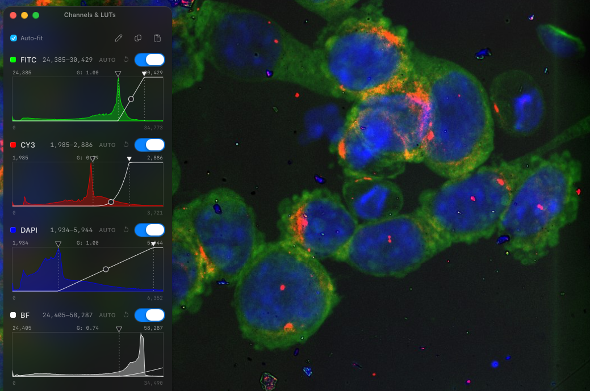

Every fluorescence channel has its own row in the Channels panel. Pick a color, turn the channel on or off, and drag the two triangles under the histogram to set the darkest and brightest values shown. ND2 without saved LUTs opens with automatic contrast and **Auto-fit** enabled, fitting each channel's axis to its signal distribution. Uncheck it to show the full integer data range, such as 0 to 65,535 for uint16. This checkbox only changes the graph, preserving image contrast. Scroll over a histogram to zoom its X axis at the pointer, scroll sideways or drag empty graph space to pan, and double-click to restore the full range. Manual navigation turns off Auto-fit without changing image contrast. Zoom uses finer histogram counts from the same sampled pyramid level. Contrast updates while you drag its handles, with the final value applied on release. The round knob bends the curve between them, which is gamma. `Auto` adjusts contrast independently of the axis mode. For typical fluorescence histograms, its lower end follows the background peak, while rare bright pixels have less influence on its upper end. This display adjustment preserves native pixel values. Hold Shift while dragging to move every channel together.

The standard viewer remembers each file's last-used minimum, maximum and gamma across app restarts. Saved LUTs take precedence over initial Auto; Reset restores the channel's metadata defaults and remembers that choice too. Preferences live in local application data, not in the image or its annotations. A moved, replaced or incompatible file uses normal defaults. The opt-in Metal viewer's independent controls are not persisted. LUT edits are saved on their own a moment after you make them; the green check at the bottom right of the pane confirms it.

For exact settings, choose the **Type LUT** pencil icon and enter each channel's minimum, maximum and gamma. Apply updates the channels together; invalid entries leave every channel unchanged, and Cancel discards the edits. Use **Copy LUT** and **Paste LUT** to reuse those settings in another window. Paste matches unique channel names regardless of order and skips unmatched, duplicate, invalid or incompatible entries. It does not copy colors or visibility and does not change raw pixels or annotations. The pencil, copy and paste actions use matching borderless 16 px Fluent icons. Hover over each icon for about one second to see a short explanation, also available with keyboard focus. A successful copy immediately changes the copy icon to a brief green check with **Copied!**.

### Translucent viewer

Click **‹** at the right of the top tab strip to expand its tools: **cloud**, **Astromapper**, **Shading Correction**, **Compare slides**, and **Slide Info**. **›** collapses them again. The cloud opens the current fluorescence image in a separate, always-on-top tracing window. It keeps the current channels, LUTs, plane, orientation and image scale. The image starts at 55% opacity; use its **Opacity** slider to adjust it from 10% to 100%. You can minimize the main viewer while using this window.

Drag the image to pan and scroll or pinch to zoom. Drag the empty top edge, or Option/Alt-drag, to move the window. Drag an edge or corner to resize it: the image scale stays fixed and only the field of view changes. The white **lock** freezes image navigation, opacity and window placement; click it again to unlock. **×** closes the tracing window. The main viewer's source tab must remain open.

Without imported coordinates, the controls are the opacity slider, lock and close. With Astromapper regions already imported in the current image, or after dropping the matching whole-image **JPG + TXT** pair into the tracing window, ROI boxes and **‹ number ›** appear. The selected ROI is emphasized. Right-click the image or use **Cmd/Ctrl+O** to choose a pair; click the number to replace it. The arrows and Left/Right keys jump to each ROI's center while preserving the current scale. Imported coordinates use the same inclusive-pixel mapping as Astromapper. Use the matching uncropped JPG with the same orientation; the files do not encode a crop or registration transform. These navigation copies do not modify saved annotations.

On the SLACS PC (Windows), **Follow** appears in the tracing window only while the SLACS program is running. The tracing window shows exactly the main viewer's rotation and flip and has no direction settings of its own, so match the orientation to SLACS in the main viewer (**⌘T / Ctrl+T**, **⌘F / Ctrl+F**) before clicking the cloud. Align the image by hand, lock it, then turn on Follow: each W, A, S or D key press in SLACS moves the tracing view up, left, down or right in the directions shown on screen, by **Step per key press** in the **⋯** settings (set it to SLACS's Roughness; 1 Roughness ≈ 1 µm). Only these key presses are followed, and only while SLACS is in front and the tracing window is locked. Unlock to realign by hand; presses made meanwhile are ignored, and following resumes from the new position once you lock again. If SLACS closes or restarts, Follow stops with a notice; turn it on again when SLACS is back. See [Stage follow](stage-follow.md) for details and limits.

On macOS the image is translucent while the white controls and ROI outlines keep their normal appearance. Windows uses native whole-window opacity, which also makes the controls and ROI outlines translucent. The mode is available in the standard desktop viewer, including its JPG/PNG tabs; a browser tab cannot float over other apps.

### Shading correction

The **Shading Correction** button in the tab strip estimates repeating illumination shading from a supported stitched ND2 scan's fluorescence. It corrects supported FITC and CY3 channels while keeping BF and DAPI unchanged; a BF channel is not required. The corrected `.nd2svs` viewing pyramid remains saved after closing and reopening the slide.

The confirmation shows the saved-pyramid notice and estimated preparation time. Choose the green **Continue** button to begin or the red **Cancel** button to dismiss. Opening a slide alone does not start a correction. During preparation, a progress bar shows the stage and approximate remaining time; Cancel stops the work before the final replacement.

After applying correction, the button offers **Revoke**. Revoke rebuilds the original viewing pyramid from the source ND2 and replaces the corrected cache. Both operations require the original ND2. Cancellation or failure before the final replacement leaves the current cache untouched. If the replacement is saved but cannot be activated immediately, the valid saved cache is retained; reopen the slide when prompted.

The model estimates a repeating template for each supported channel with an amplitude that varies across the scan. FITC and CY3 are assessed separately; DAPI can contribute pattern proposals but is never corrected. BF pixels, BF-derived geometry and camera priors do not enter fitting. Unsupported channels keep their original values. If no channel supports a correction, the original pyramid is retained. Plate/time-series acquisitions and Z projections remain unsupported. See the [method and validation limits](shading-correction-validation.md).

PNG, JPEG and SVG exports use the saved correction and include `shading-corrected` in their filenames. Native ND2/TIFF exports, including reduced-resolution exports, and pixel readouts retain original values. The original ND2, annotations and saved LUTs remain unchanged. Temporary preparation files are released after the operation; the corrected viewing cache remains saved until revoked.

Previously saved corrections remain readable with their saved models; an application update does not silently refit them. Use **Revoke**, then **Apply**, to fit again with the current method.

A color brightfield slide such as an H&E opens with a light window, and a fluorescence scan opens with a dark one. You can switch either way with the appearance button.

Move the cursor over the slide and the status bar shows the raw value of every channel at that pixel, straight from the file. Press `I` for a small readout that follows the cursor.

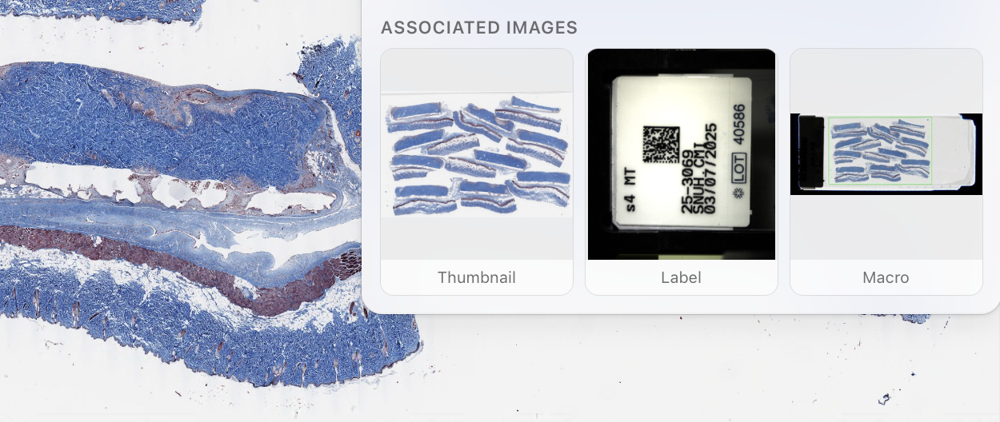

Press `⌘I` for Slide Info. It lists the pixel size and where it came from, the objective, the size of the scan, and the space the reduced copies take on disk. For an SVS it also shows the label and the macro photo stored inside the file.

On macOS, the tab strip and toolbar take the place of a separate title bar. Drag their empty space to move the window using native Cocoa window dragging, including after a display configuration changes. Double-click either one to zoom the window, as you would a title bar, and double-click again to bring it back. The gesture follows the title bar setting in System Settings under Desktop & Dock. Windows retains its standard title bar and window buttons.

The mark at the left of the toolbar names the kind of file in two words. 2D or 3D says whether the file holds a z stack, and SLIDE or PLATE says whether it holds one scan position or several. A stitched scan reads 2D SLIDE and the phage assay reads 3D PLATE.

### Time series of a plate

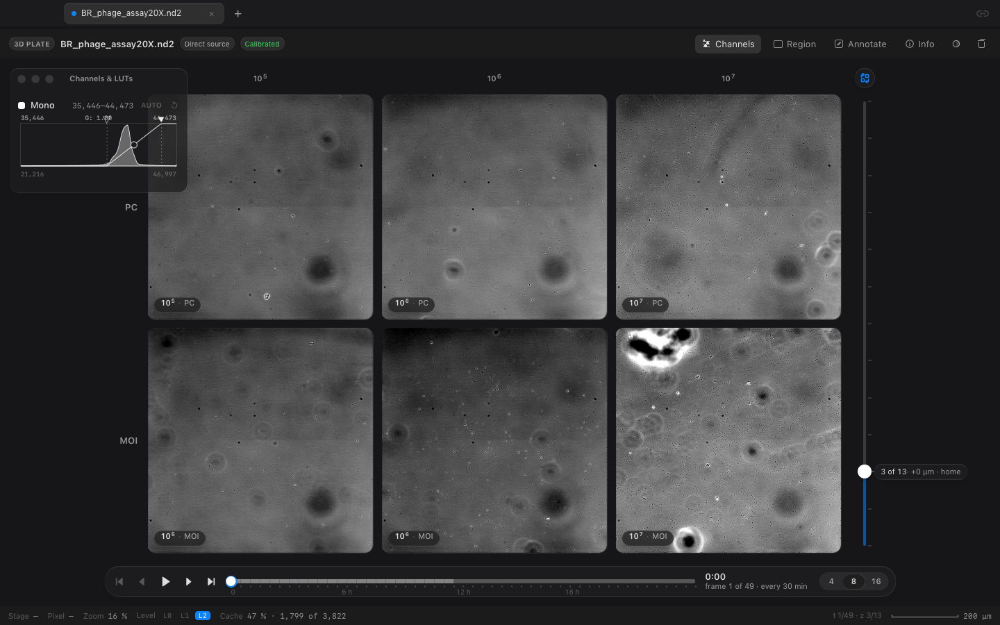

Some ND2 files are not scans. A time lapse of a plate stores one camera field per site, repeated over z planes and over time, with no stitched whole-slide plane. The viewer opens these files in plate mode and reads frames from the ND2. It prepares reduced frames beside the file in the background; the status bar shows progress. Available reduced frames are warmed into memory to improve navigation. Preparation time, cache size and responsiveness depend on the acquisition and storage.

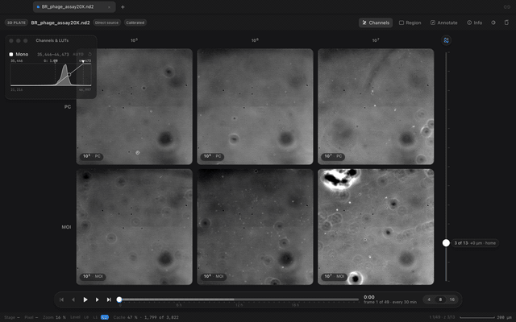

The sites sit in a grid. Coordinate names such as `A01` become lettered and numbered row and column headers, so a label does not cover every small image. Lab patterns such as `10(5)_MOI` still become condition and dilution headers. The transpose button swaps rows and columns, and the choice is remembered. The slider on the right is the z plane, and the capsule under the grid is time. A plate with only one z plane or one time point hides the corresponding control automatically. The toolbar's **View** menu can show or hide Site Labels, Timeline, and Z Axis at any time.

Autofocus compares every Z plane for each site and time point. It uses the gradient detail of the mean image of all raw channels, independently of the visible channel selection. The toolbar button becomes available when a current site's full Z curve is ready, and remains accessible when the timeline is hidden. Only complete curves are applied: the grid reports `AF 4/6 ready`, with incomplete sites staying at the manual plane. The Z readout shows the range of planes actually displayed. Reaching for the Z control returns to a shared manual plane; in focused mode it steps from that site's displayed plane. A single-position acquisition opens focused, and a single-Z file hides autofocus.

Two gestures do most of the work. Over the grid, a vertical scroll moves through z and a horizontal swipe on the trackpad scrubs time. Click a site, or press its number, and it fills the stage as a deep zoom, where a vertical scroll zooms, a horizontal swipe still scrubs time, and Option with a vertical scroll moves through z. With keyboard focus on a grid cell, arrows move between sites and Enter opens one. On the image stage, arrows step z and time, Space plays, and Esc or the All sites capsule returns to the grid. Time and Z controls also support keyboard adjustment and announce their values to assistive technology.

In the deep zoom the ruler, pins, boxes, pixel values, and region export all work on the frame you are looking at. Marks are kept per site in a small file beside the ND2 and are shared across time and z planes. Slide Info lists the sites and their arrangement, the z planes with their step and home, the length of the series and the interval between frames, and the exposure.

The grid has no implicitly selected site. Choose a site to measure pixels, view its histogram or use Auto LUT, edit/import/export annotations, or export a region. Manual channel visibility, window and gamma controls still apply to every site in the grid. A plate's **Full Field** export is the selected site's current T/Z frame. Changing sites clears the region; changing T/Z within one site keeps its geometry and refreshes the preview. Pending pixel and histogram responses from an older frame cannot replace the current result.

## Measuring and marking

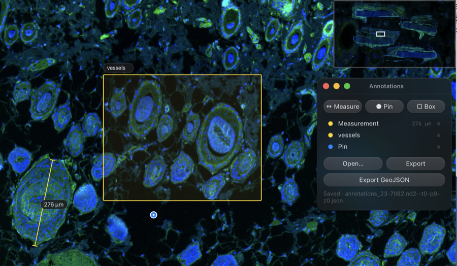

Press `M` and drag for a ruler, `P` for a pin, and `B` for a box. Each mark can carry a note.

The ruler is honest about its numbers. It counts full-resolution pixels between its two ends and multiplies by the micrometers per pixel that the file itself recorded, the voxel size in an ND2 or the MPP tag in an SVS. If a file carries no trustworthy calibration, the ruler reports pixels instead of inventing a number.

Marks are saved automatically and come back the next time you open the slide. Press `⌘⇧E` to export them as `.geojson`, or choose **Open** in Annotations to import a QuPath GeoJSON file. Imported marks are added to the existing marks and saved with them. Opening a native `.annotations.json` file replaces the current set.

A small green check at the bottom right of the pane, next to the scale bar, means the last change to your marks (including Astromapper regions) or LUTs was auto-saved. Hover over it, or focus it with the keyboard, to see how long ago that was. The check turns grey while a change is waiting to be written, orange when a save failed and will be retried every minute, and red for a conflict with another window, which still needs the recovery notice in Annotations.

GeoJSON uses the matching image's full-resolution pixel coordinates. Points, lines and polylines, polygons with holes, and their multipart forms retain their coordinates and feature metadata through import and export. Coordinates are not scaled, clipped, or aligned. Files without source metadata are labelled **source not verified**: check that the file belongs to the open image. Viewer exports include the source name, dimensions, and frame selection, which are checked when present on import.

QuPath ellipses, geometry collections, and annotations tied to a non-default channel, Z plane, or time point are not supported. Convert ellipses to polygons before export. An invalid or unsupported feature rejects the whole import and leaves the existing marks intact. The import limit is 8 MB, 10,000 features, and 250,000 coordinate points.

<a id="numbered-regions-with-astromap"></a>

### Numbered regions with Astromapper

Open **Astromapper** with the star or **⌘⇧A / Ctrl+Shift+A**.
Expand the top tools first to reveal the star. Shift-drag to add a rectangle,
or choose **Add current region**. In a **Link scale + frame** comparison,
Shift-drag adjusts the pane's alignment; use **Add current region** to add an ROI.
Click an ROI number to centre it **without changing the current zoom**;
the selected region is yellow and the others are grey. While the panel is open,
press **Left / Right** to select and centre the previous or next ROI in the list
at the same zoom. Navigation stops at the first and last region. When editing a
note, the arrow keys keep their normal text-editing behaviour.

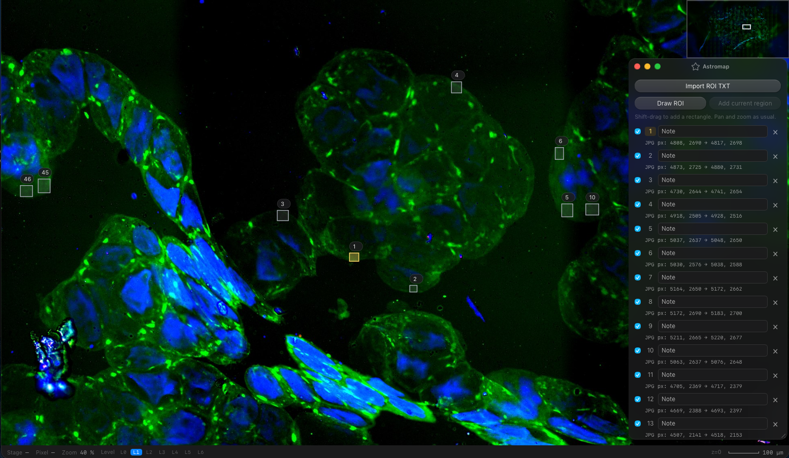

**Import ROI TXT** accepts Astromapper coordinates. Select the matching
whole-image JPG, or enter that coordinate image's width and height. The viewer
scales the coordinates into the current image and includes the end pixels.
Use the corresponding uncropped image in the same orientation: dimensions alone
cannot account for a crop or register a different image.
Up to 2000 regions can be imported. Invalid rows or coordinates outside the
confirmed reference image reject the import and leave existing annotations intact;
the error identifies the affected index and reference dimensions. Check the
coordinate file and its matching image rather than assuming a region-count limit.

**Export JPG + TXT** creates a ZIP with a small whole-image JPEG and matching
coordinates. **Export ZIP with PDF** adds a landscape report with numbered ROI
views. **Clear all** removes the Astromapper regions while keeping ordinary
annotations.

## Cutting out a region

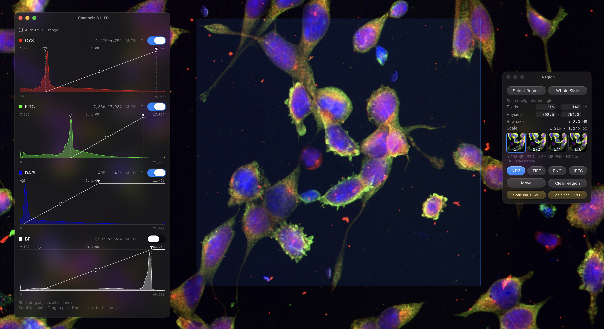

Press `E` to open the Export panel, choose **Select Region**, and drag a box, or type a size in pixels or micrometers. Then choose a format.

| Format | What you get |
|---|---|
| ND2 | the original numbers of the selected channels, as a new ND2 file |
| TIFF | the original numbers, as a tiled TIFF |
| PNG or JPEG | a picture of the region exactly as it looks on screen |
| Scale bar + SVG | a lossless PNG image embedded in an SVG, with an editable vector scale bar and label |
| Scale bar + JPEG | a high-quality JPEG with the calibrated scale bar and label baked in |

Native-resolution ND2 and TIFF exports preserve source channel values, or decoded RGB for colour slides. Reduced-resolution exports resample those values, and lossy source formats cannot recover pre-compression microscope samples. PNG and JPEG apply the current display colours and contrast; use source data for quantitative intensity analysis.

### Editable scale bars in Adobe Illustrator

Choose **Scale bar + SVG** to export a single SVG file combining the rendered PNG with a white vector bar and text label. The label uses **Arial by default**. Open it in Adobe Illustrator to edit the label's font or move the bar. The embedded microscopy image keeps the selected export resolution; SVG does not turn it into vector artwork or add image detail.

The horizontal bar is calibrated from the file's recorded micrometers per pixel, adjusted for the selected export scale: **bar width (px) = bar length (µm) ÷ (source µm/px × downsample factor)**. For example, a half-resolution export uses twice the source µm/px. Scale-bar export is unavailable without valid calibration. In Illustrator, resize the image and bar together to preserve their physical relationship; do not stretch the bar independently.

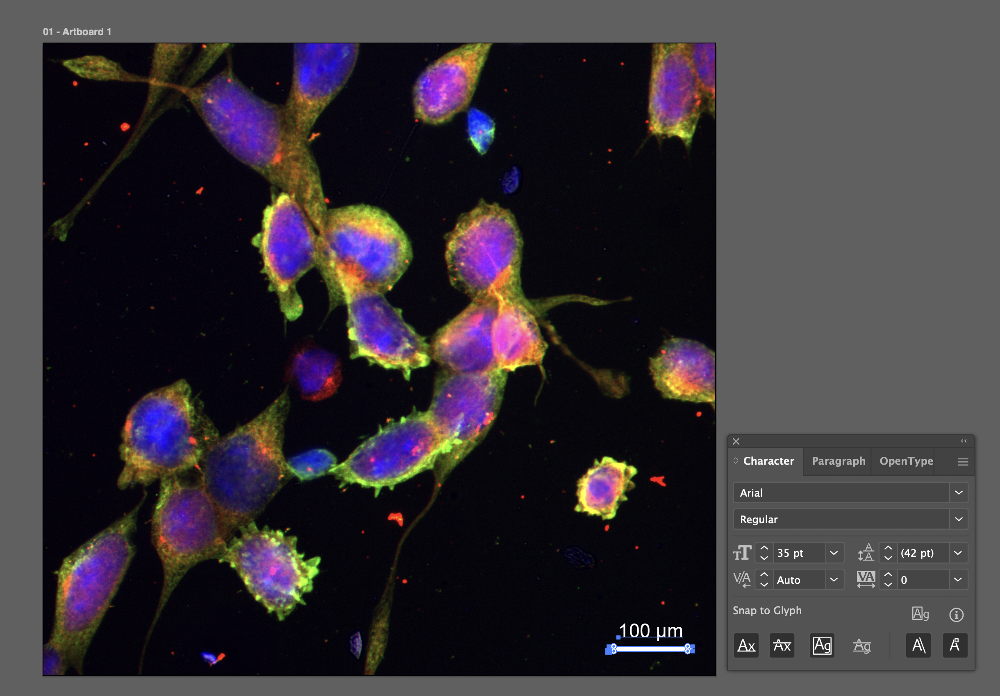

*The microscopy image is raster PNG; the scale bar and its label are separate, editable SVG elements.*

### Exporting the whole slide

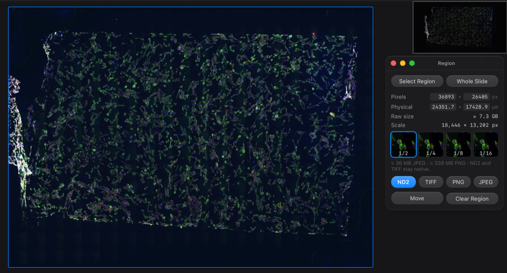

The **Whole Slide** button selects the entire slide. In plate mode, **Full Field** selects the current site’s T/Z frame. A very large picture export is made at a reduced size instead of at native resolution, and the panel tells you the size it will produce.

## Comparing scans and serial sections

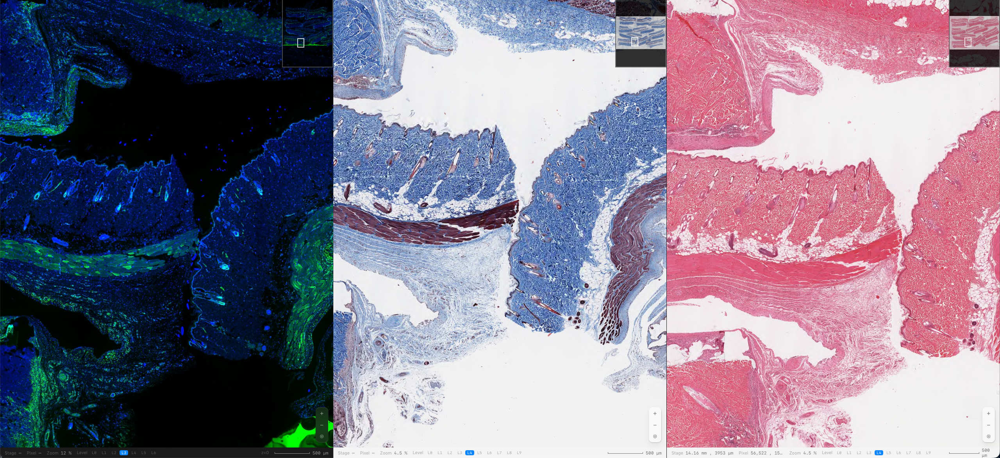

From left: immunofluorescence (IF), Masson's trichrome (MT), and H&E serial sections. After manual alignment, **Link scale + frame** moves the three views together.

Open two or more slides, press `⌘\`, and choose which slide to compare with the one in front. Then choose **Off**, **Link scale**, or **Link scale + frame**. Link scale matches micrometres per displayed pixel while letting you move each image independently; Link scale + frame also links movement using the alignment. Press `+` in the capsule to add more slides, up to four. Two slides share the screen, three take a column each, and four fill a grid. Physical linking requires valid pixel calibration in every image; incompatible pixel shapes or orientations show a reason instead of claiming equal scale. Zoom percentages may differ between scans because their pixel sizes differ. Here, frame means viewport position, not acquisition T/P/Z indices.

Scans taken through opposite sides of the glass may need a reflection, not just a rotation. In Compare, choose the image in **Active linked slide**, then use **Flip ↔** (`⌘F`), **Flip ↕**, **↶ 90°**, **↷ 90°** (`⌘T`), or **Transpose** (swap the displayed horizontal and vertical axes). These are image-orientation controls, distinct from transposing the well grid. The reference stays fixed; only the selected linked image changes, around the current view center. **Reset Orientation** restores its original orientation without resetting that center. The viewer does not guess the orientation from `.svs` or `.nd2` filenames. Pair orientations are remembered while the app remains open.

The comparison toolbox's **×** only hides the tools: the linked panes and their alignment stay active. Use the **Show comparison tools** sliders button beside the tab-bar **Compare slides** button to reopen them. The tab-bar **Stop comparing slides** button (or `⌘\`) ends the comparison; the link button inside the toolbox opens the three linking choices without closing the panes. Hiding tools also preserves an in-progress landmark edit, which can be resumed by reopening the toolbox.

To calibrate orientation and manually align the sections, press **Align**. Choose four distinctive histological features that can be recognized across the sections, then click their corresponding locations in the same order on the reference and each linked image. Each linked image is fitted to the shared reference. **Done** applies the fits together once every image has four points and each fit is valid.

<p align="center">
  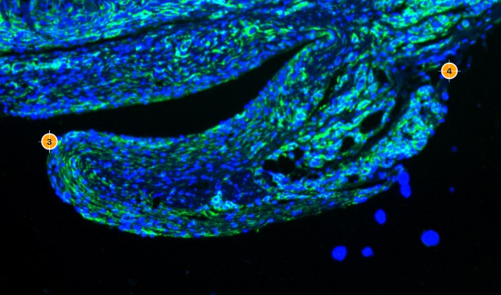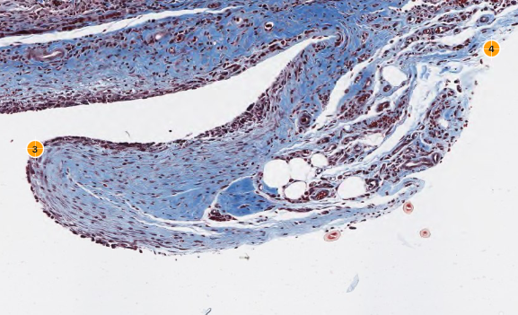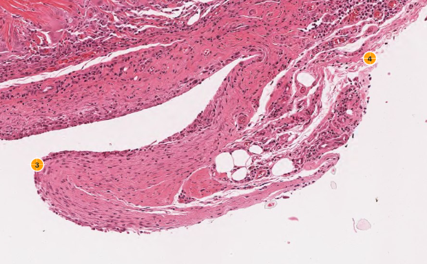
</p>

The close-ups show landmarks **3** and **4** on corresponding tissue features, in the same IF, MT, H&E order as the overview. These manually chosen landmarks establish the viewing alignment; they do not prove that individual cells correspond across serial sections.

The viewer fits rotation, uniform scale and shift, preserving the current mirror state unless **Infer mirror** is selected. This is similarity alignment, not perspective or deformable registration. Landmark residuals are shown in micrometers when calibrated (relative units otherwise). **Cancel** preserves the previous alignment, and **Clear Points** clears only the draft. A fitted image's orientation buttons and shortcuts remain protected until **Remove Fit** removes the committed fit. These are display transforms: source pixels, annotation coordinates, and raw exports remain unchanged.

Local offsets can remain at high magnification because serial sections differ in depth and shape. With **Link scale + frame**, hold **Shift** while dragging to adjust one pane while the others stay in place. Finish the drag, release Shift, then pan normally to resume linked movement. The adjusted offset remains. **Option/Alt-drag** also moves one pane alone. The arrow keys move the linked slide by one screen pixel, or ten with Shift. Each adjustment becomes part of the alignment. Scale-only movement does not alter the saved alignment.

## What the viewer writes on your disk

Everything the viewer makes goes into one folder beside the slide.

```text
experiment/
├── slide.nd2
└── nd2wsi/
    ├── annotations/     your pins, rulers, boxes, and notes
    └── caches/
        └── slide.nd2--t0-p0-zmid.nd2svs
```

Version 2.0 stores each cache as one `.nd2svs` file. It contains the manifest,
OME-Zarr v2 metadata and compressed image chunks in an application-owned SQLite
container, with no permanent companion database files. This avoids the allocation
overhead of thousands of small files on external drives. Open the source scan or
the `.nd2svs` file directly in the viewer; no unpacking is required.

The original scan is never modified. A compact cache contains reduced levels,
**not the original full-resolution ND2**. Move the scan and its `nd2wsi` folder
together to retain native-resolution viewing and annotations. Moving only a
compact cache allows overview-only viewing, with annotation editing disabled
until the matching source is available. Pins, rulers and ROIs remain separate in
`nd2wsi/annotations/` and are never discarded with the cache.

Older directory caches remain readable. Opening a source scan with a matching
managed scan-pyramid directory cache creates a verified single-file copy and
keeps the old directory; deletion of the old copy is a separate explicit cleanup.
Legacy multi-site plate directory caches are reused read-only without conversion.
Portable `.ome.zarr` exports
remain supported and are not converted or removed automatically. A tiled SVS
normally needs no additional cache.

Viewing caches are retained for future opens. macOS 2.1.1 no longer exposes a
cache-delete button in the viewer; source scans and annotations remain separate.

## Keyboard

Shortcuts act on the image workspace. Image tools are ignored while typing in a text field, editing a note, or composing text with an input method (IME), so normal text-entry shortcuts remain available. **New Window** (`⌘N` / `Ctrl+N`) remains an application-level command, including from a text field. `⌘C` and `⌘A` also keep their native copy/select-all behavior while meaningful text is selected, including in Slide Info. On Windows, use Ctrl instead of ⌘.

### Panels and tools

| Key | Action |
|---|---|
| `C` | show or hide Channels & LUTs |
| `E` | show or hide Export |
| `A` | show or hide Annotations |
| `M` | measure |
| `P` | place a pin |
| `B` | draw a box |
| `V` | move the selected region |
| `0` | fit the slide |
| `I` | pixel values under the cursor |
| `⌘I` | Slide Info |
| `⌘⇧A` | show or hide Astromapper |
| `⌘N` / `Ctrl+N` on Windows | open a separate viewer window |
| `⌘1` … `⌘9` | switch to that tab |
| `⌘⇧E` | export marks as GeoJSON |
| `Esc` | cancel the active tool, or return to all sites |

### Orientation and comparison

| Key | Action |
|---|---|
| `⌘T` | rotate the image 90° clockwise on screen (`⌘R` also works) |
| `⌘F` | flip the image horizontally on screen |
| `⌘\` | link slides |
| `L` | choose Off, Link scale, or Link scale + frame |
| `←` `→` `↑` `↓` | nudge the linked slide by a pixel, ten with Shift |
| `Shift` drag | adjust one linked pane; finish the drag and release Shift before panning normally with the new offset |
| `⌥ / Alt` drag | move one linked pane alone |

`⌘T` and `⌘F` change the focused image when slides are unlinked. Annotations and ROI overlays follow the image; their saved source coordinates remain unchanged. In Compare, these shortcuts change the image selected in **Active linked slide**, while the reference stays fixed. They follow the same protections as the orientation buttons: choose **Remove Fit** before changing a fitted image, and open a site before orienting a plate image. They do not rotate or flip the plate grid.

In the image workspace, `⌘T` and `⌘F` control orientation. `⌘R` remains an alias for a clockwise turn. Holding an orientation shortcut applies only one change; release and press again for another. Plain `C` opens Channels, `A` opens Annotations, `E` opens Export, and `P` places a pin. `⌘C` and `⌘A` remain available as aliases when they do not conflict with native copy/select-all. Plain `R` remains reserved.

### Plate navigation

| Key | Action |
|---|---|
| `↑` `↓` | z plane of a plate |
| `←` `→` | time frame of a plate |
| `Space` | play or pause a plate |
| `F` | follow the sharpest plane of each site |
| `1` to `9` | open a site of a plate |

These navigation shortcuts apply on the image stage; arrows instead move between sites when a grid cell has keyboard focus, and Enter opens that site. While movement is linked in Compare, arrows nudge the linked image and plate navigation shortcuts are paused. Plain `F` toggles autofocus only for an eligible plate with multiple Z planes when autofocus is ready; otherwise it does nothing. Use `⌘F` to flip an image.

## Questions and requests

### An older version freezes while installing an update

Version 1.2.8 fixes a main-thread deadlock in the app's preparation for an update. Annotation saving and file-handle cleanup now run in the background; Sparkle resumes on the main thread only after they finish. Aborted attempts cannot resume a later installation.

An older app still runs its old updater code before it can replace itself. If it freezes at this step, save your work and close the viewer, download the latest DMG from [Releases](https://github.com/myunghyunj/nd2wsi-viewer/releases/latest), and replace the app in Applications once. Keep your slide files, annotation sidecars, and viewing caches; none need to be deleted for this repair.

The viewer grew out of one lab's need for speed, so it does what that lab needed first. If something is missing or unclear, open an [issue](https://github.com/myunghyunj/nd2wsi-viewer/issues).

